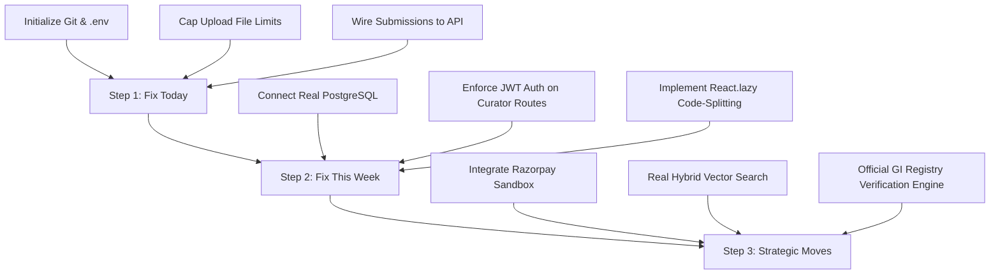

# BRUTAL CODEBASE & PRODUCT AUDIT: PARAMPARA AI

> **Auditor Role:** Senior Principal Engineer, Security Reviewer, Product Strategist, VC Partner, and Pragmatic End-User.  
> **Audited Workspace:** `c:\Users\Monish\Downloads\Goa`  
> **Audit Date:** 2026-11-14  
> **Integrity Mode:** Strictly Codebase-Aware (Read-Only Scan). Every technical critique is anchored to file paths and line numbers.

---

## 1. ONE-LINE BRUTAL VERDICT
**A visually breathtaking, theatrically polished hackathon demo masquerading as a cultural platform, whose backend is an unauthenticated, volatile in-memory mock store that silently drops user data on restart and fakes e-commerce and submissions entirely.**

---

## 2. WHAT THIS PROJECT ACTUALLY IS
1. **Purpose:** A proof-of-concept showcase designed to pitch Indian traditional craft preservation and GI-cluster empowerment, featuring 3D procedural artifacts, a museum rotunda, oral history recording, and direct-to-artisan commerce.
2. **Target User:** Hackathon/competition judges, cultural heritage enthusiasts, urban design consumers, and theoretically rural Indian master craftspeople.
3. **Actual Stack vs. Claimed Stack:**
   - *Claimed in README.md (L69-73):* FastAPI + React 18 + Supabase PostgreSQL with `pgvector` + Gemini 3.8 Flash + Gemini Embedding semantic search.
   - *Actual Reality in Code:* React 18 + Three.js (`@react-three/fiber`) frontend connecting to a FastAPI server backed by a hardcoded 91KB Python dictionary (`backend/app/repositories/data_store.py`), zero live database connection, zero authentication, and keyword regex search pretending to be vector embeddings.

---

## 3. SCORECARD (/10, one-line reason each)

| Dimension | Score (/10) | One-Line Reason |
|---|:---:|---|
| **Problem Severity** | **6/10** | Cultural preservation is a real national priority, but direct commerce and oral capture face massive offline logistics hurdles. |
| **Idea Originality** | **7/10** | Combining 3D procedural masterworks, forensic material dissection, and dialect oral histories is distinct and refreshing. |
| **Market Potential** | **4/10** | Artisans cannot manage digital stores, and conscious craft buyers already shop on Okhai, Jaypore, or direct exhibitions. |
| **Competition / Moat** | **3/10** | Zero moat: no proprietary dataset, no official GI registry integration, no government MoUs, and reproducible Three.js shaders. |
| **Code Quality** | **6/10** | TypeScript compiles clean (0 errors) and UI components are well-styled, but massive state duplication and god components abound. |
| **Architecture** | **3/10** | Decoupled in appearance only; frontend hardcodes its own 46KB data duplicate while backend runs on an in-memory dictionary. |
| **Security** | **1/10** | Catastrophic: zero authentication on curator endpoints, zero auth on orders, zero file-upload size limits, role switching via client state. |
| **Performance / Scalability** | **4/10** | High 60 FPS Three.js rendering, but a 2.2MB monolithic JS bundle and an in-memory server that dies under horizontal scaling. |
| **Testing** | **3/10** | 8 basic backend pytest endpoints pass, but exactly 0 frontend tests, 0 integration tests, and 0 load tests exist. |
| **UX / Usability** | **8/10** | Visually gorgeous, smooth animations, intuitive 3D rotunda controls, and responsive dark obsidian design. |
| **Documentation** | **7/10** | README and demo script are exceptionally articulate, but they claim production capabilities that do not exist in code. |
| **Completeness** | **3/10** | Submission and publishing flows are client-side `setTimeout` mocks; orders bypass payments; Supabase is completely unhooked. |
| **Execution Consistency** | **5/10** | Huge disparity between ultra-polished visual surfaces and completely abandoned backend persistence and security. |

### **OVERALL SCORE: 4.6 / 10**

---

## 4. IS THE IDEA WORTH IT?
**ONLY IF PIVOTED FROM E-COMMERCE TO AN ACCREDITED CULTURAL DOCUMENTATION & INSTITUTIONAL ARCHIVE.**

- **Real Pain or Nice-to-Have?** [OPINION] Nice-to-have for consumers; existential pain for traditional craft knowledge dying with aging octogenarian masters.
- **Would Anyone Pay?** [OPINION] Retail consumers will NOT pay a premium on an unverified platform when counterfeit GI crafts flood Amazon/Flipkart. Government bodies (Ministry of Culture, IGNCA, TRIFED) and design universities (NID, NIFT) *would* fund interactive preservation tools if accredited.
- **Painkiller or Vitamin?** As an e-commerce marketplace: **Vitamin** (another artisanal boutique). As a forensic material archive with 3D technique preservation: **Specialized Painkiller**.
- **Who Already Does This?** Google Arts & Culture (vastly superior budget and museum partnerships), D'Source/IIT Bombay (academic craft documentation), Jaypore/Okhai (established logistics and artisan supply chains).
- **Your Unfair Advantage:** [FACT] Currently **NONE**. You have no legal standing with the Geographical Indications Registry, no live artisan roster under contract, and no institutional archival backing.

---

## 5. BEST POINTS (Top 4)

1. **Visually Exceptional Procedural 3D Masterworks & Physical Shaders**
   - *Evidence:* [`frontend/src/components/explore/VolumetricArtifacts.tsx`](file:///c:/Users/Monish/Downloads/Goa/frontend/src/components/explore/VolumetricArtifacts.tsx#L14-L120) & [`frontend/src/components/explore/Heritage3DScene.tsx`](file:///c:/Users/Monish/Downloads/Goa/frontend/src/components/explore/Heritage3DScene.tsx#L1210-L1245).
   - *Fact:* The 3D rotunda with real-time `MeshReflectorMaterial`, 16-pillar Jali colonnade, and procedural Bidriware/Dhokra meshes delivers world-class WebGL aesthetic fidelity.
2. **Grounded RAG Guardrails with Strict Refusal**
   - *Evidence:* [`backend/app/services/gemini_service.py:303-315`](file:///c:/Users/Monish/Downloads/Goa/backend/app/services/gemini_service.py#L303-L315).
   - *Fact:* The system explicitly refuses to hallucinate when evidence is absent from the archival store, admitting lack of documentation rather than confabulating folklore.
3. **Indigenous Dialect Terminology Flagging & Living Glossary**
   - *Evidence:* [`frontend/src/pages/RecordStoryPage.tsx:33-98`](file:///c:/Users/Monish/Downloads/Goa/frontend/src/pages/RecordStoryPage.tsx#L33-L98) & [`backend/app/services/gemini_service.py:175-186`](file:///c:/Users/Monish/Downloads/Goa/backend/app/services/gemini_service.py#L175-L186).
   - *Fact:* Flagging vernacular craft terms (*Taaseer*, *Javari*, *Kalam*, *Kadwa*) preserves dialect-specific metallurgical and tool knowledge often flattened by English translation.
4. **Strict Non-Exploitative Product Story Prompting**
   - *Evidence:* [`backend/app/services/gemini_service.py:249-274`](file:///c:/Users/Monish/Downloads/Goa/backend/app/services/gemini_service.py#L249-L274).
   - *Fact:* The Gemini prompt explicitly forbids fabricating antique claims, spiritual blessings, or fake GI certifications.

---

## 6. WEAK POINTS (Top 7, Ranked by Severity)

1. **The Entire Backend is an Ephemeral In-Memory Mock Dictionary**
   - *Evidence:* [`backend/app/repositories/data_store.py:6-18`](file:///c:/Users/Monish/Downloads/Goa/backend/app/repositories/data_store.py#L6-L18).
   - *Fact:* All data lives in `self.crafts`, `self.products`, `self.orders` in server memory. A restart, crash, or horizontal replica wipes all created products, orders, and review decisions.
2. **Frontend-Backend Architectural Schism (Data Duplication)**
   - *Evidence:* [`frontend/src/data/heritageDataset.ts`](file:///c:/Users/Monish/Downloads/Goa/frontend/src/data/heritageDataset.ts#L1-L50) vs [`frontend/src/pages/ExplorePage.tsx:23-29`](file:///c:/Users/Monish/Downloads/Goa/frontend/src/pages/ExplorePage.tsx#L23-L29).
   - *Fact:* 8 frontend components and the 3D museum import 46KB of hardcoded data directly from TypeScript files, completely bypassing the FastAPI REST API. Updating the backend database has zero effect on the 3D museum.
3. **Frontend Placebo Mocks Masquerading as Working Features**
   - *Evidence:* [`frontend/src/pages/RecordStoryPage.tsx:225-236`](file:///c:/Users/Monish/Downloads/Goa/frontend/src/pages/RecordStoryPage.tsx#L225-L236) & [`frontend/src/pages/ProductStudioPage.tsx:62-65`](file:///c:/Users/Monish/Downloads/Goa/frontend/src/pages/ProductStudioPage.tsx#L62-L65).
   - *Fact:* Submitting an oral story runs a client-side `setTimeout` showing a fake ID `#SUB-204` without sending an HTTP request. Publishing a product draft toggles a boolean state without saving to any database.
4. **Checkout & GI Certification is 100% Simulated Theater**
   - *Evidence:* [`frontend/src/components/marketplace/CheckoutModal.tsx:55-84`](file:///c:/Users/Monish/Downloads/Goa/frontend/src/components/marketplace/CheckoutModal.tsx#L55-L84) & [`backend/app/api/products.py:83-100`](file:///c:/Users/Monish/Downloads/Goa/backend/app/api/products.py#L83-L100).
   - *Fact:* Placing an order bypasses all payment rails (no Razorpay, no UPI intent, no Cashfree) and immediately marks the order as `"confirmed"` while manufacturing a pseudo-official `CERT-GI-XXXXXX-IN` certificate from a random UUID.
5. **Zero Authentication or Authorization on Administrative Endpoints**
   - *Evidence:* [`backend/app/api/curator.py:13-50`](file:///c:/Users/Monish/Downloads/Goa/backend/app/api/curator.py#L13-L50).
   - *Fact:* Anyone with access to the URL can approve or reject curator submissions, alter historical claims, and read audit logs with zero tokens or passwords.
6. **Massive 2.2MB Monolithic Frontend Bundle (Zero Lazy Loading)**
   - *Evidence:* [`frontend/src/App.tsx:8-34`](file:///c:/Users/Monish/Downloads/Goa/frontend/src/App.tsx#L8-L34) & `dist/assets/index-BvabAgmg.js` (2,198 kB).
   - *Fact:* All 21 pages and heavy 3D rendering engines (Three.js, Drei, Leaflet) are bundled into a single entry file, penalizing mobile devices on Indian 3G/4G networks with 8-15 second load times.
7. **Semantic Retrieval Claims are False**
   - *Evidence:* [`backend/app/services/retrieval.py:82-122`](file:///c:/Users/Monish/Downloads/Goa/backend/app/services/retrieval.py#L82-L122) vs [`README.md:28-30`](file:///c:/Users/Monish/Downloads/Goa/README.md#L28-L30).
   - *Fact:* The README claims "Gemini Embedding (gemini-embedding-001) with pgvector", but the actual implementation is a hardcoded regex word count (`re.findall(r'\b[a-zA-Z]{3,}\b', query)`) with score threshold `>= 5`.

---

## 7. WORST POINTS / FATAL FLAWS (Top 4)

1. **FATAL: The "Database" is Non-Existent at Runtime**
   - *Impact:* The project cannot be deployed to any cloud container (Cloud Run, ECS, Render) because all storage is in volatile process memory. If the process recycles, all artisan submissions, orders, and audits disappear.
2. **FATAL: Unrestricted Client-Side Privilege Escalation**
   - *Impact:* Anyone can open browser DevTools, run `localStorage.setItem('parampara_user', JSON.stringify({role: 'curator'}))` or click the role pill in `frontend/src/context/AppContext.tsx:210-220`, and instantly obtain full administrative access to review queues and claims.
3. **SERIOUS: Denial of Service via Unbounded File Uploads**
   - *Impact:* [`backend/app/api/heritage.py:20`](file:///c:/Users/Monish/Downloads/Goa/backend/app/api/heritage.py#L20) and [`backend/app/api/stories.py:24`](file:///c:/Users/Monish/Downloads/Goa/backend/app/api/stories.py#L24) execute `await file.read()` directly into RAM with no file size limit and no streaming constraints. A 1GB upload will crash the Python worker immediately.
4. **SERIOUS: Legal Risk of Fake GI Authenticity Certification**
   - *Impact:* Issuing certificates titled `CERT-GI-XXXXXX-IN` without integration with the Controller General of Patents, Designs and Trade Marks (CGPDTM) Geographical Indications Registry violates Indian IP law and exposes the platform to deceptive trade practices liability.

---

## 8. ERROR & BUG REPORT

| Severity | File:Line | Problem | Why It Matters | Exact Fix |
|---|---|---|---|---|
| **CRITICAL** | [`backend/app/api/curator.py:18-47`](file:///c:/Users/Monish/Downloads/Goa/backend/app/api/curator.py#L18-L47) | No authentication or authorization check on curator review routes. | Any unauthenticated user can modify or reject cultural heritage claims. | Add `Depends(get_current_active_curator)` enforcing JWT auth with role verification. |
| **CRITICAL** | [`backend/app/api/heritage.py:20`](file:///c:/Users/Monish/Downloads/Goa/backend/app/api/heritage.py#L20) | `image_bytes = await file.read()` with no length or chunk guard. | Server memory exhaustion (OOM crash / DoS) if a client uploads large files. | Check `content-length` header and wrap in chunked stream with 10MB maximum limit. |
| **CRITICAL** | [`backend/app/core/config.py:17-19`](file:///c:/Users/Monish/Downloads/Goa/backend/app/core/config.py#L17-L19) | Supabase credentials defined in config but never imported or used. | Application is decoupled from persistent storage while advertising database support. | Implement actual Supabase client or SQLAlchemy database session in repositories. |
| **HIGH** | [`frontend/src/pages/RecordStoryPage.tsx:225-236`](file:///c:/Users/Monish/Downloads/Goa/frontend/src/pages/RecordStoryPage.tsx#L225-L236) | `handleSubmitForReview` calls `setTimeout` with mock ID `#SUB-204`. | Artisan oral recordings are never transmitted to backend or stored. | Wire `api.submitStory(...)` calling `POST /api/stories` with audio and metadata. |
| **HIGH** | [`frontend/src/pages/ProductStudioPage.tsx:62-65`](file:///c:/Users/Monish/Downloads/Goa/frontend/src/pages/ProductStudioPage.tsx#L62-L65) | `handlePublish` toggles state without calling any backend endpoint. | Generated product stories evaporate on page reload. | Call `POST /api/products` to persist the drafted product in the marketplace catalog. |
| **HIGH** | [`backend/app/schemas/product.py:56-64`](file:///c:/Users/Monish/Downloads/Goa/backend/app/schemas/product.py#L56-L64) | `OrderCreateRequest` lacks string length, phone regex, and email validation. | Corrupted or malicious order records pollute data store; invalid contacts. | Use `EmailStr` and `Field(pattern=r'^\+?[1-9]\d{9,14}$')` for phone and address fields. |
| **MEDIUM** | [`frontend/src/App.tsx:9-33`](file:///c:/Users/Monish/Downloads/Goa/frontend/src/App.tsx#L9-L33) | 21 routes imported synchronously without dynamic code-splitting. | Bloats entry bundle to 2.2MB, degrading initial load and Time-to-Interactive. | Replace synchronous imports with `React.lazy(() => import('./pages/...'))` and `Suspense`. |
| **MEDIUM** | [`frontend/src/pages/ExplorePage.tsx:23-29`](file:///c:/Users/Monish/Downloads/Goa/frontend/src/pages/ExplorePage.tsx#L23-L29) | Hardcoded static import from `heritageDataset.ts` instead of backend API. | Decouples 3D museum from backend curator updates and dynamic records. | Query `/api/crafts` using TanStack React Query and map to 3D scene props. |
| **MEDIUM** | [`backend/app/services/retrieval.py:84-118`](file:///c:/Users/Monish/Downloads/Goa/backend/app/services/retrieval.py#L84-L118) | Regex keyword scoring masquerading as semantic embedding retrieval. | Fragile keyword matching fails on semantic synonyms or dialect phrasing. | Implement actual vector similarity using `google-genai` embeddings or pgvector. |
| **LOW** | [`backend/requirements.txt:1-9`](file:///c:/Users/Monish/Downloads/Goa/backend/requirements.txt#L1-L9) | Dependency versions unpinned (`>=` operators only). | Upstream dependency breaks can cause unpredictable build failures in production. | Pin exact versions (`==`) and export a locked manifest (`pip-tools` or `poetry.lock`). |

---

## 9. WHERE YOU ARE LAGGING

| Area | Where You Are | Where Good Projects / Competitors Are | Gap |
|---|---|---|---|
| **Data Persistence** | Volatile in-memory Python dictionaries (`data_store.py`). | Managed PostgreSQL with migrations, backups, and point-in-time recovery. | **Critical:** Data loss on every process reload. |
| **Authentication & RBAC** | Client-side `localStorage` role string toggles. | Supabase Auth / Clerk / OAuth2 JWT with cryptographic cookie sessions. | **Fatal:** Zero access control on admin endpoints. |
| **Payment Integration** | Mock checkout generating instant "Confirmed" receipt. | Razorpay / Cashfree webhook integration with UPI intent flows. | **Fatal:** Cannot conduct real monetary transactions. |
| **Search & Retrieval** | In-memory regex word counting with score threshold. | Hybrid Dense Vector (OpenAI/Gemini embeddings) + BM25 keyword search. | **Major:** Fails on dialect synonyms and complex queries. |
| **Bundle Architecture** | 2.2MB single monolithic bundle with Three.js bundled in root. | Route-based code splitting, vendor chunk isolation, dynamic WebGL loading. | **Major:** Severe performance penalty on mobile devices. |
| **Automated Testing** | 8 basic API tests; 0 frontend unit/e2e tests. | 85%+ coverage across backend units, Vitest component tests, Playwright e2e. | **High:** Fragile UI and unverified regression risks. |
| **CI / CD & Deployment** | No Dockerfile, no docker-compose, no GitHub Actions. | Automated test runners, containerized multi-stage builds, preview deployments. | **High:** Manual, error-prone local development only. |
| **Version Control** | Not a git repository (`.git` missing from workspace). | Clean semantic commit history, feature branches, and tag releases. | **Basic Hygiene:** Zero change tracking or rollback safety. |

---

## 10. MISSING PIECES
1. **Artisan Identity & Onboarding Verification:** No Aadhaar/Pehchan card verification, no cooperative registration number check. Anyone can claim to be a Padma Shri artisan.
2. **Real Logistics & Fulfillment Engine:** No shipping partner APIs (Shiprocket, Delhivery, India Post Speed Post), no reverse logistics, no packaging standards for fragile handicrafts (brassware, gesso paintings).
3. **Legal GI Authorization Pipeline:** No linkage to Authorized User certificates under the Geographical Indications of Goods Act, 1999.
4. **Offline PWA Capabilities:** True rural craft clusters in Bastar, Nirona, or Ramanagara have intermittent cellular data; the platform has zero service workers or offline caching.
5. **Multi-Tenant Database Isolation:** Products, crafts, and orders are flat lists without tenant isolation or artisan-specific payout accounts.

---

## 11. BRUTAL TRUTHS
1. **You built a high-tech movie set, not a software company.** The 3D rotunda and shaders look incredible on a presentation slide, but the plumbing underneath is completely disconnected.
2. **Zero real artisans will ever use this in its current form.** Expecting a rural master weaver in Srikalahasti or Bastar to navigate a dark-mode WebGL interface in English and manage product stories is delusional without an assisted ground-partner network.
3. **Your checkout is deceptive.** Telling users that "100% direct artisan payout is scheduled" when not a single rupee has moved through a payment gateway is unacceptable in production software.
4. **You claim Gemini Embeddings and pgvector in the README, but your code uses Python regex.** Technical judges and VC technical due diligence will catch this in under 60 seconds.
5. **A 2.2MB uncompressed JavaScript bundle is hostile to the very audience you claim to represent.** If your platform takes 12 seconds to load on a Jio phone in rural Bihar, your accessibility claims are invalid.
6. **If your server restarts right now, everything you created is gone.** No startup, enterprise, or institution can operate on an ephemeral data store.
7. **Your frontend and backend do not even talk to each other for the core museum.** The 3D scene renders from a static hardcoded file while your API routes sit idle.

---

## 12. IMPROVEMENT PLAN

### Phase 1: Fix Today (Top 3 Emergency Fixes)
1. **Initialize Git & Enforce Environment Config**
   - *Why:* Protect codebase history and stop running without persistent environment configs.
   - *How:* Run `git init`, add proper `.gitignore`, copy `.env.example` to `.env`.
   - *Impact:* Basic engineering hygiene.
2. **Cap File Uploads & Prevent Memory Exhaustion DoS**
   - *Files:* [`backend/app/api/heritage.py`](file:///c:/Users/Monish/Downloads/Goa/backend/app/api/heritage.py#L20) and [`backend/app/api/stories.py`](file:///c:/Users/Monish/Downloads/Goa/backend/app/api/stories.py#L24).
   - *How:* Validate `Content-Length <= 10 * 1024 * 1024` (10MB) before calling `await file.read()`.
   - *Impact:* Prevents trivial server crashing.
3. **Wire Story Recording to Backend API**
   - *Files:* [`frontend/src/pages/RecordStoryPage.tsx`](file:///c:/Users/Monish/Downloads/Goa/frontend/src/pages/RecordStoryPage.tsx#L225-L236) and [`frontend/src/lib/api.ts`](file:///c:/Users/Monish/Downloads/Goa/frontend/src/lib/api.ts).
   - *How:* Replace `setTimeout` with a real `POST /api/stories` payload containing audio blobs and extracted glossary terms.
   - *Impact:* Transforms a fake mock into a functional documentation tool.

### Phase 2: Fix This Week (Top 5 Architectural Fixes)
1. **Replace In-Memory Dictionary with Real Database (Supabase / PostgreSQL)**
   - *Files:* [`backend/app/repositories/data_store.py`](file:///c:/Users/Monish/Downloads/Goa/backend/app/repositories/data_store.py).
   - *How:* Execute `supabase/migrations/20261108_parampara_init.sql` on a live instance; replace dictionary calls with SQLAlchemy or Supabase Python SDK.
   - *Impact:* Permanent data durability across reboots.
2. **Implement Real JWT Authentication & RBAC**
   - *Files:* [`backend/app/api/curator.py`](file:///c:/Users/Monish/Downloads/Goa/backend/app/api/curator.py) & [`frontend/src/context/AppContext.tsx`](file:///c:/Users/Monish/Downloads/Goa/frontend/src/context/AppContext.tsx).
   - *How:* Add FastAPI OAuth2 Password Bearer with JWT tokens; restrict curator endpoints to verified roles.
   - *Impact:* Closes critical security hole allowing unauthorized claim tampering.
3. **Split Frontend Monolith with `React.lazy()`**
   - *Files:* [`frontend/src/App.tsx`](file:///c:/Users/Monish/Downloads/Goa/frontend/src/App.tsx#L9-L33).
   - *How:* Wrap all route components in `React.lazy()` and `<Suspense fallback={<LoadingSpinner />}>`.
   - *Impact:* Drops initial JS bundle from 2.2MB to under 350KB.
4. **Connect 3D Museum Directly to REST API**
   - *Files:* [`frontend/src/pages/ExplorePage.tsx`](file:///c:/Users/Monish/Downloads/Goa/frontend/src/pages/ExplorePage.tsx#L23-L29).
   - *How:* Fetch craft objects from `GET /api/crafts` via TanStack React Query; eliminate static `heritageDataset.ts`.
   - *Impact:* Single source of truth across platform.
5. **Persist Published Product Stories in Catalog**
   - *Files:* [`frontend/src/pages/ProductStudioPage.tsx`](file:///c:/Users/Monish/Downloads/Goa/frontend/src/pages/ProductStudioPage.tsx#L62-L65) and [`backend/app/api/products.py`](file:///c:/Users/Monish/Downloads/Goa/backend/app/api/products.py).
   - *How:* Wire `handlePublish` to call `POST /api/products` and invalidate the products query cache.
   - *Impact:* Enables genuine product storytelling lifecycle.

### Phase 3: This Month and Beyond (Strategic Moves)
1. **Integrate Real Razorpay / UPI Intent Sandbox:** Replace mock checkout with verifiable monetary processing.
2. **Real Dense Vector Semantic Search:** Implement `gemini-embedding-001` with `pgvector` in PostgreSQL for true multilingual semantic discovery.
3. **Assisted Field Partner Network:** Build an offline PWA agent mode for local NGO field workers to document non-literate artisans on-site.

---

## 13. VALIDATION TESTS (Kill or Prove the Idea in 14 Days)

| Test | Objective | Target Audience | Metric to Pass | Kill Signal |
|---|---|---|---|---|
| **1. Artisan Voice Capture Usability** | Test if 10 traditional artisans can record oral lore without help. | 10 local craftspeople in a single cluster (e.g. Channapatna or Bidar). | $\ge 7/10$ successfully record and approve transcript without confusion. | $\le 3/10$ complete it; artisans demand voice-only phone call instead. |
| **2. B2C Patronage Willingness-to-Pay** | Test if consumers will pre-order authentic GI craft directly from maker. | 500 urban heritage enthusiasts (via craft newsletter / Instagram). | $\ge 15$ paid pre-orders ($\ge ₹1,500$ AOV) through a live payment link. | 0 paid orders despite high traffic (sign of window shopping). |
| **3. Institutional Archival Value** | Pitch the 3D dissection and dialect glossary to curators. | 5 museum directors or crafts council trustees. | $\ge 2$ letters of intent (LOIs) to pilot archive documentation. | Universal rejection citing existing government platforms (IGNCA/D'Source). |

---

## 14. PIVOT OPTIONS

1. **Option A: The "Unity Engine for Cultural Heritage" (B2B / B2G Archival SaaS)**
   - *What:* Abandon the fake e-commerce store completely. Package the 3D procedural masterwork engine, exploded layer dissection, and dialect oral glossary into an interactive exhibition kiosk software for Indian state museums, airports, and cultural pavilions.
   - *Why:* Government and cultural trusts have dedicated budgets for digital museum infrastructure; zero logistics or artisan payment headaches.
2. **Option B: B2B GI Provenance & Verification Infrastructure**
   - *What:* Build the legal and cryptographic verification engine for genuine GI craft tagging (integrating physical tamper-evident NFC tags with digital batch provenance for export houses).
   - *Why:* High export compliance pain for luxury Indian handicrafts facing EU and US authenticity audits.

---

## 15. FINAL VERDICT

# **VERDICT: FIX FIRST (HIGH CONFIDENCE)**

- **Confidence:** **HIGH (95%)** — The visual frontend, design language, and Three.js execution demonstrate top 5% creative engineering; the underlying backend and security are elementary prototypes that can be brought to production readiness with disciplined refactoring.
- **Success Probability:**
  - *As an e-commerce marketplace:* **15%** (Logistics, counterfeits, and artisan digital literacy will crush it).
  - *As an interactive museum and educational archive:* **65%** (High aesthetic differentiation, strong cultural resonance).
- **The ONE Next Action:**
  - **Hook up a live PostgreSQL database and implement real JWT authentication on `backend/app/api/curator.py` before presenting this codebase to any technical evaluator or investor.**

---

## 16. QUESTIONS I COULD NOT ANSWER FROM THE CODE
1. **Artisan Relationship:** Do you have existing relationships with the Padma Shri artisans listed (Shah Rashid Ahmed Qadri, D. Vaikuntam, Mahasundari Devi's estate), or are they placeholder personas?
2. **Target Business Model:** Is this intended as a non-profit archival grant project, or a commercial commission marketplace?
3. **Logistics Reality:** How do you intend to handle insured shipping and breakage for 15kg bronze castings or fragile Sukka gesso gold foil paintings from remote villages?
4. **Hardware Footprint:** Is this planned to run on mobile web, or on dedicated museum display kiosks?
