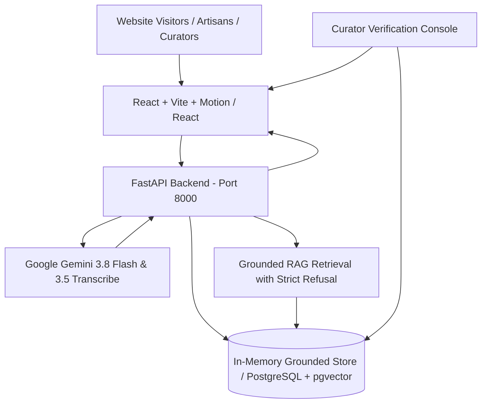

# PARAMPARA AI — Cultural Heritage Preservation & Artisan Empowerment Platform (Pan-India)

[](https://github.com/parampara-ai)
[](https://fastapi.tiangolo.com)
[](https://react.dev)
[](https://motion.dev)
[](https://vitejs.dev)
[](https://ai.google.dev)
[](LICENSE)

> **"Most platforms show the craft. PARAMPARA AI preserves the living knowledge behind it, keeps Indian master artisans connected to their cultural heritage, and makes it responsibly discoverable across India's traditional craft clusters."**

---

## 1. Overview & System Architecture

PARAMPARA AI is an exclusively **Pan-India living digital heritage archive and artisan empowerment studio**. Rather than functioning as an ungrounded chatbot or commercial reseller, it connects four previously isolated pillars:
1. **The Craft:** 8 Pan-Indian GI-certified traditions across North, South, East, West, and Central zones with authentic photography, process demonstration reels, and timestamped chapter bookmarks.
2. **The Knowledge:** Spoken oral memories recorded in native Indian languages (Hindi, Telugu, Gujarati, Kannada, Tamil, etc.) with dialect terminology flags.
3. **The People:** Living master artisans (including Padma Shri and National Award recipients) with explicit contributor consent, guild attribution, and zero-commission direct contacts.
4. **The Opportunity:** Verified directory of Ministry of Textiles fellowships, TRIFED expos, and Crafts Council of India grants in Indian Rupees (`₹`).



---

## 2. Documented Pan-Indian Craft Clusters (8 Verified Traditions)

| Tradition | Geographic Cluster | Zone | GI Registry / Status | Video Process Masterclass |
|---|---|---|---|---|
| **Bidriware Metal Inlay** | Bidar, Karnataka | South | GI Application No. 17 | 4:45 • Alloy Casting, Tarkashi Silver Inlay, Bidar Fort Soil Oxidation |
| **Srikalahasti Kalamkari** | Tirupati, Andhra Pradesh | South | GI Registry No. 19 | 5:15 • Buffalo Milk Treatment, Kasim Inking, Swarnamukhi River Bleaching |
| **Rogan Art of Kutch** | Nirona Village, Gujarat | West | UNESCO Nomination | 4:15 • 48-Hour Castor Oil Boiling, Brass Stylus Flying Thread |
| **Bastar Dhokra Casting** | Bastar & Kondagaon, CG | Central | GI Registry No. 83 | 4:50 • 4,000-Year Lost-Wax (Cire Perdue), Anthill Clay & Beeswax |
| **Thanjavur Gold Painting** | Thanjavur, Tamil Nadu | South | GI Registry No. 24 | 4:30 • Sukka Limestone Relief Gesso, 22K Pure Gold Leaf Pressing |
| **Madhubani Mithila Art** | Madhubani, Bihar | East | GI Registry No. 105 | 4:20 • Bamboo Stylus Inking, Cow Dung Wash, Kachni Cross-Hatching |
| **Kashmir Pashmina** | Srinagar & Budgam, J&K | North | GI Registry No. 46 | 5:40 • 12-Micron Changthangi Fleece, Yender Wheel, Kani Loom |
| **Channapatna Lacquerware** | Ramanagara, Karnataka | South | GI Registry No. 4 | 3:50 • Aale Mara Wood Lathe Turning, Vegetable Lacquer Polish |

---

## 3. Core Product Modules & Smooth Interactions

| Module | Purpose | Realization in Prototype |
|---|---|---|
| **1. Heritage Lens** | Multimodal visual exploration | Gemini 3.8 Flash visual feature extractor with glowing laser scanning beam animation, 6 Pan-India sample arts, and strict uncertainty disclaimers. |
| **2. Digital Heritage Vault** | Structured craft records | Sequential process stages, natural materials, primary archival sources (National Crafts Museum, ASI, IGNCA), and embedded `CraftVideoPlayer` with clickable chapter bookmarks. |
| **3. Voice of Tradition** | Oral knowledge capture | In-browser audio recorder with animated pulsing sound waves (`motion/react`), Gemini 3.5 Transcribe draft with dialect term verification, and explicit consent agreement. |
| **4. Artisan Studio** | Maker workspace | Profile editor, product story generator creating dignity narratives strictly from verified facts, and direct enquiry in INR (`₹`) with zero intermediary cut. |
| **5. Heritage Q&A** | Grounded retrieval assistant | RAG architecture citing specific Indian archives; explicitly refuses to answer when evidence is absent from the archive. |
| **6. Opportunity Connect** | Curated opportunities directory | Verified listings for Ministry of Textiles fellowships, TRIFED Aadi Mahotsav, and Crafts Council exhibitions with deadlines. |

---

## 4. Technology Stack

- **Frontend:** React 18, Vite 5.4, TypeScript, Tailwind CSS with customized Indian cultural design tokens, Lucide Icons, `motion/react` for smooth physics-based animations.
- **Backend:** Python 3.13, FastAPI, Pydantic, Uvicorn, Google GenAI SDK (`google-genai` 3.0.0), NumPy, Pytest.
- **AI Models:** Google Gemini 3.8 Flash (`gemini-3.8-flash`) for multimodal understanding & RAG generation; Gemini 3.5 Transcribe (`gemini-3.5-transcribe`) for audio speech transcription; Gemini Embedding (`gemini-embedding-001`) for semantic retrieval.
- **Database:** Seeded data repository + Supabase PostgreSQL schema with `pgvector` and Row Level Security (RLS) policies.

---

## 5. Quick Start (Running Locally)

### 5.1 Backend (FastAPI)
```powershell
# 1. Run test suite
$env:PYTHONPATH="."
.\backend\.venv\Scripts\pytest.exe .\backend\tests\test_api.py -v

# 2. Start development server on port 8000
python -m uvicorn backend.app.main:app --host 0.0.0.0 --port 8000 --reload
```

Swagger API Docs available at: `http://localhost:8000/docs`

### 5.2 Frontend (React + Vite)
```powershell
cd frontend

# Build production bundle (verified 0 errors)
npm.cmd run build

# Start Vite dev server on port 5173
npm.cmd run dev
```

Open your browser at: `http://localhost:5173`

---

## 6. Live Judge Demonstration Path (4–5 Minutes)

1. **Pan-India Heritage Home (`/`):** View the animated hero entrance and interactive living craft video player. Filter traditions by Indian zone (South, North, West, East, Central) with smooth layout dynamics.
2. **Interactive Process Video (`/explore/bidriware`):** Open Bidriware and click chapter bookmarks (`0:20 Zinc Casting`, `1:15 Chisel Engraving`, `2:30 Silver Inlay`, `3:40 Fort Soil Oxidation`) to watch sequential stages.
3. **Heritage Lens AI Scanner (`/heritage-lens`):** Test sample arts (Dhokra Bronze, Kalamkari, Rogan Art, Thanjavur Gold Foil). Watch the animated laser scan line and review visible physical features and non-certifying AI disclaimer.
4. **Voice of Tradition (`/studio/stories/new`):** Speak or choose sample Hindi / vernacular audio. Watch animated audio waves, review the Gemini 3.5 Transcribe draft with flagged dialect terms, and select attribution & consent choices.
5. **Grounded Heritage Q&A (`/explore/bidriware`):** Ask *"Why is Bidar Fort soil used for blackening the metal?"* to see grounded citations from the National Crafts Museum. Ask an out-of-domain question to witness grounded refusal.
6. **Zero-Commission Artisan Studio (`/artisans/rashid-qadri`):** View Padma Shri Shah Rashid Qadri's profile with direct commission enquiry in INR (`₹`) without platform cuts.
