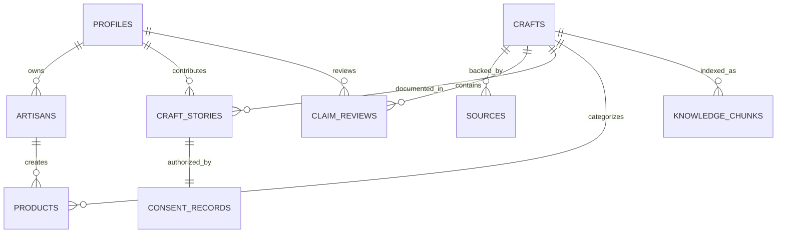
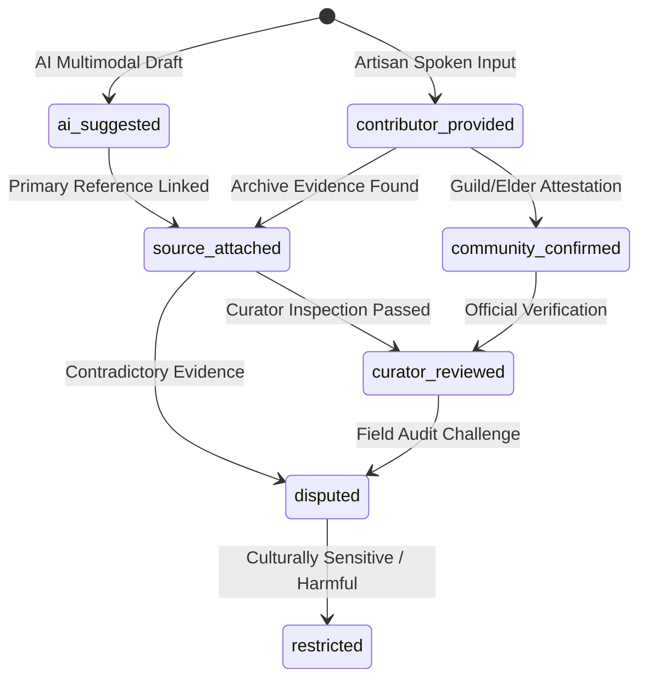

# PARAMPARA AI — Data Model & Lifecycle Specification

## 1. Entity Relationship Diagram

---

## 2. Claim-Level Status State Machine

A critical differentiator of PARAMPARA AI is that **records are not treated as a monolithic binary "verified/unverified" checkbox**. Individual factual claims carry distinct evidential states:

### Claim Status Definitions:
- `ai_suggested`: Raw machine-generated observation; draft only.
- `contributor_provided`: Direct statement from artisan oral history.
- `source_attached`: Direct citation to published museum catalog, GI registry, or scholarly monograph.
- `community_confirmed`: Attested by local artisan collective, guild, or recognized master craftsperson.
- `curator_reviewed`: Verified and signed off by an authorized heritage reviewer.
- `disputed`: Conflicting regional traditions or disputed historical assertion; requires investigation.
- `restricted`: Cultural or ceremonial knowledge restricted from general public display.

---

## 3. Record Lifecycle

1. **Capture:** Contributor records audio or uploads photo in Artisan Studio.
2. **AI Draft:** Gemini prepares preliminary transcription and structures fields; explicitly flagged as `is_draft: true`.
3. **Contributor Editing:** Contributor corrects terms, sets consent scope, and chooses attribution (`named`, `collective`, `anonymous`).
4. **Curator Review:** Curator inspects sources, adjusts claim statuses, and approves/rejects publication.
5. **Preservation:** Approved public records are stored in PostgreSQL and vector-indexed for Heritage Q&A.
6. **Discovery & Opportunity:** Public visitors explore the craft and connect with the maker; artisans leverage approved records to create product story cards.
